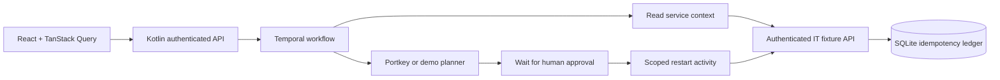

# DeskPilot

A runnable portfolio implementation of an IT support agent: **Kotlin + Temporal + Portkey + React/TanStack Query**. It retrieves service evidence, proposes remediation, and requires a separate approver before executing a scoped tool.

## What you can demonstrate

- Start a VPN investigation from the dashboard and inspect its evidence and execution timeline.
- Approve or reject the proposed restart with a separate approver credential.
- Observe one-hour approval expiry, bounded activity retries, and durable Temporal workflow history.
- Retry a remediation request without duplicating its effect: the fixture API stores idempotency keys in SQLite.
- Enable Portkey for model-generated proposals; leave it unset for a deterministic, zero-cost demo.

**Scope:** This is a local reference implementation. The bundled IT API simulates service operations; it does not administer real infrastructure. Live gateway calls require your own credentials and were not used to produce the demo results.

## Architecture



Temporal owns workflow durability, retries, signals, and event history. Portkey is the optional model gateway. Model output is a proposal: it never receives credentials or executes tools. The executable service/action scope is fixed in code.

## Local quick start

Requirements: Java 21, Python 3.11+, Node 22+, pnpm 11, and the [Temporal CLI](https://docs.temporal.io/cli).

```sh
cp .env.example .env
# Replace the three demo tokens for your local session.
set -a; . ./.env; set +a
```

Use separate terminals from the repository root:

```sh
# 1. Development Temporal server (local only)
temporal server start-dev --db-filename temporal.db
```

```sh
# 2. Authenticated IT fixture API
set -a; . ./.env; set +a
python3 demo/it_api.py
```

```sh
# 3. Kotlin API and Temporal worker
set -a; . ./.env; set +a
./gradlew run
```

```sh
# 4. Dashboard
cd web
pnpm install --frozen-lockfile --ignore-scripts
pnpm dev
```

Open http://localhost:5173, enter your operator token, and investigate `vpn`. The fixture reports VPN as degraded; email and helpdesk as healthy. Enter your approver token to approve or reject a restart. Tokens remain in React memory and are not stored in localStorage.

## API

| Endpoint | Credential | Behavior |
|---|---|---|
| `POST /api/incidents` | Operator | Starts a workflow from `{ "service": "vpn", "description": "VPN unavailable" }` |
| `GET /api/incidents/{id}` | Operator | Returns status, plan, evidence, and audit timeline |
| `POST /api/incidents/{id}/decision` | Approver | Signals `{ "approved": true }` or false |

The API listens on loopback. Activity calls use a separate IT integration credential. Unrecognized services are rejected. A first accepted decision wins; repeated decisions cannot run another restart. Requests have size limits. Temporal's full workflow history records signals and activity outcomes; the dashboard shows a compact state timeline.

## Tests

```sh
./gradlew test
python3 -m unittest discover -s demo -p 'test_*.py' -v
cd web && pnpm build
```

Workflow tests use Temporal's time-skipping test server, so approval expiry takes seconds rather than an hour. See [validation notes](docs/VALIDATION.md) for tested behavior and limitations.

## Optional live planning

Set `PORTKEY_API_KEY`, `PORTKEY_VIRTUAL_KEY`, and `PORTKEY_MODEL` in your local environment. The planner calls Portkey's chat-completions endpoint with JSON output. Gateway latency and total token usage are returned in the plan. Do not commit real credentials. Provider billing is external; no inference-cost claims are made for the zero-cost demo.

For configurable model comparisons, fault injection, and estimated inference costs, see the companion [FailureLab](https://github.com/a-akheel/failurelab).

## Design tradeoffs and next steps

- Local shared role tokens demonstrate scope separation; production needs OIDC identities, per-resource authorization, TLS, and managed secrets.
- SQLite atomically records simulated actions. A real downstream system must guarantee idempotency across the actual side effect and durable result; this fixture is not proof of distributed exactly-once execution.
- Approval does not automatically revalidate service health after an hour. Production should bind approvals to a versioned plan and recheck evidence before execution.
- Workflow failures become a visible `failed` state. Temporal history contains the underlying activity failures; no sensitive provider response is returned to the browser.
- Prompt-injection resistance requires both model evaluations and enforced tool boundaries. Prompt wording alone is not a security guarantee.

References: [Temporal Java SDK](https://docs.temporal.io/develop/java), [Temporal message passing](https://docs.temporal.io/encyclopedia/workflow-message-passing), [Portkey gateway](https://github.com/Portkey-AI/gateway).

MIT licensed.
