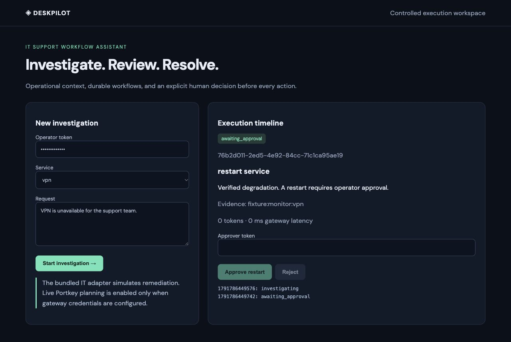
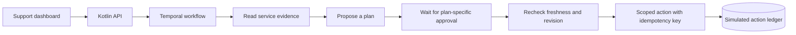

# DeskPilot

[](https://github.com/a-akheel/deskpilot/actions/workflows/ci.yml)

**An IT support workflow assistant that asks before it acts.**

DeskPilot investigates a selected service, proposes a restart, and waits for a separate approver. Before executing, it checks the service evidence again. The interesting part is what happens when an approval gets old, a worker restarts, or a response disappears after an action commits.

Kotlin · Temporal · React/TanStack Query · optional Portkey



## Run the local demo

Runs locally in demo mode without API keys. Connecting a live model is optional and requires your own credentials.

Install Java 21, Python 3.11+, Node 22+, pnpm 11, and the [Temporal CLI](https://docs.temporal.io/cli). Then:

```sh
python3 scripts/dev.py
```

Open **http://127.0.0.1:5173**. The launcher prints temporary operator and approver tokens; enter them in the matching fields. Choose VPN, start an investigation, then approve or reject it. Ctrl-C stops the services. Runtime data and logs stay in ignored `.runtime/` files. Ports 7233, 8233, 8080, 8091, and 5173 must be free.

The launcher uses the free deterministic planner. The bundled IT API **simulates** service operations; it does not change real infrastructure. For individual services or live planning, see [setup](docs/SETUP.md).

## What is tested

| Check | Evidence |
|---|---|
| Approval, rejection, expiry, wrong plan, duplicate decisions | Temporal workflow tests |
| Changed or stale evidence prevents execution | Workflow tests and HTTP integration |
| Three-attempt retry budget | Workflow tests and HTTP integration |
| Lost response after commit does not duplicate a simulated action | Workflow tests and SQLite ledger checks |
| A replacement process resumes the original approval | FailureLab process-restart test |
| Recorded history replays deterministically | Temporal history replay test |

The companion [FailureLab](https://github.com/a-akheel/failurelab) runs **16 HTTP cases plus an actual worker-process restart** against DeskPilot. Its [saved report](https://github.com/a-akheel/failurelab/blob/main/examples/deskpilot-report.json) contains workflow snapshots and action counts. These are deterministic integration results, not live-model benchmarks.

```sh
./gradlew test
python3 -m unittest discover -s demo -p 'test_*.py' -v
cd web && pnpm install --frozen-lockfile --ignore-scripts && pnpm build
```

## How it works



See [design decisions](docs/DESIGN.md), [validation](docs/VALIDATION.md), and the [two-minute walkthrough](docs/WALKTHROUGH.md).

## Boundaries

This is a local portfolio prototype. Role tokens demonstrate permission separation, not production identity management. Monitoring revisions are checked before execution, but a real adapter must also enforce its own atomic preconditions. The fixture's transaction covers its simulated effect; it does not establish exactly-once behavior for an external restart.

MIT licensed.
